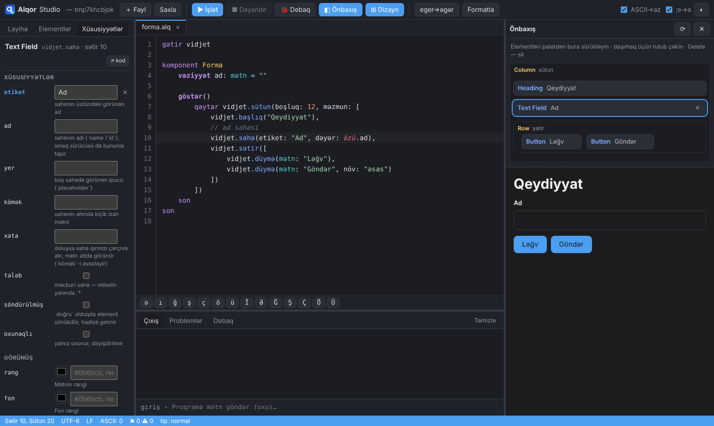
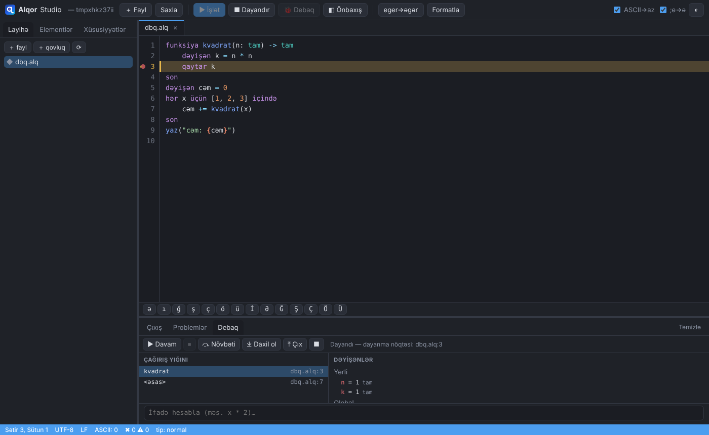

<p align="center">
  <picture>
    <source media="(prefers-color-scheme: dark)" srcset="loqo/alqor-loqo-qaranliq.svg">
    
  </picture>
</p>

<h1 align="center">Alqor</h1>

<p align="center">
  <b>Azərbaycan dilində düşünən proqramlaşdırma dili.</b><br>
  Açar sözlər, xəta mesajları, sənədlər və IDE — hamısı ana dilimizdə.<br>
  Bir dildə konsol proqramı, veb sayt, desktop tətbiq və brauzer kodu yazın.
</p>

<p align="center">
  <b>Versiya 2.4</b> ·
  <a href="https://github.com/vugarfamiloglu/alqor/releases/latest">Endir</a> ·
  <a href="https://vuqar.pro/alqor">Sayt</a> ·
  <a href="https://vuqar.pro/hub">Paketlər</a>
</p>

<p align="center">
  <code>əgər</code> · <code>hər ... üçün</code> · <code>funksiya</code> · <code>sinif</code> · <code>cəhd et</code> · <code>gözlə</code>
</p>

---

```alqor
sinif Tələbə
    qurucu(açıq xassə ad: mətn, açıq xassə bal: tam)

    metod qiymət() -> mətn
        seç
            hal özü.bal >= 90 → qaytar "əla"
            hal özü.bal >= 70 → qaytar "yaxşı"
            digər hallarda    → qaytar "kafi"
        son
    son
son

dəyişən qrup = [Tələbə("Aysel", 95), Tələbə("Elçin", 78), Tələbə("Nərmin", 64)]

hər t üçün qrup.sıralanmış((t) => -t.bal) içində
    yaz("{t.ad}: {t.bal} bal — {t.qiymət()}")
son
```

```
Aysel: 95 bal — əla
Elçin: 78 bal — yaxşı
Nərmin: 64 bal — kafi
```

## Niyə Alqor?

Dünyada milyonlarla insan proqramlaşdırmaya ingilis dilini öyrənməklə
başlayır. Məktəbli üçün `if`, `while`, `return` — sadəcə əzbərlənən səslərdir.
**Alqor maneəni aradan qaldırır:** alqoritmi öz dilində düşünən, öz dilində
yazır və kompüter ona öz dilində cavab verir.

Bu bir oyuncaq dil deyil. Alqor müasir dillərin gücünü daşıyır:

| | |
|---|---|
| 🧠 **Müasir dil** | Siniflər, miras, interfeyslər, cəbri sadalamalar, naxış uyğunlaşdırma, qapanmalar, generatorlar, `asinxron`/`gözlə`, tədrici tiplər |
| 🇦🇿 **Azərbaycan dili, ciddi şəkildə** | `ı/İ` qaydası ilə böyük-kiçik hərf (`"ışıq".böyüyə()` → `IŞIQ`), əlifba sırası ilə sıralama (`ə` `e`-dən sonra gəlir, `z`-dən sonra yox), `5.yazıyla()` → `beş` |
| 💬 **Anlaşılan xətalar** | Hər xəta Azərbaycanca, kodu ilə, səhvin yeri göstərilir və düzəliş təklif olunur |
| ⌨️ **Hər klaviaturada** | `eger` yazsanız `əgər` kimi qəbul olunur — Azərbaycan klaviaturası olmayan kompüterdə də işləyir |
| 🌐 **Bir dil — dörd hədəf** | Konsol, veb server, desktop pəncərə və **JavaScript** (Node.js / brauzer) |
| 🐍 **Python ekosistemi** | `gətir python:numpy kimi np` — istənilən Python/PyPI kitabxanası birbaşa; `alqor python qur requests` layihəyə quraşdırır |
| ⚡ **Sürətli icraçı** | Rust ilə yazılmış bytecode virtual maşın — Python icraçısından ~100 dəfə sürətli (`alqor işlət --motor rs`) |
| 🛠 **Tam alət dəsti** | IDE, paket meneceri, formatlayıcı, linter, sınaq işlədicisi, sənəd generatoru, LSP, debaqçı |

## Xətalar sizinlə danışır

```alqor
dəyişən yaş = 25
yaz("Yaş: " + yaş)
```

```
✖ ALQ-T008  Operator bu tiplərə tətbiq edilmir
   ┌─ salam.alq:2:13
   │
  2│ yaz("Yaş: " + yaş)
   │             ^ `mətn` və `tam` toplanmır
   │
  = kömək: interpolyasiya işlədin: "mətn: {dəyər}"
  = kömək: və ya çevirin: mətn + mətnƏt(dəyər)
```

Siz `cəm` əvəzinə `cem` yazdınız? Alqor bunu da tutur:

```
✖ ALQ-T006  ArqumentXətası: `siyahı[tam]` tipində `cem` üzvü yoxdur — `cəm` demək istəyirdiniz?
```

## Bir dil — veb, desktop, konsol, brauzer

**Veb server** — marşrutlar, şablonlar, sessiyalar, JSON API, WebSocket:

```alqor
gətir veb

dəyişən s = yeni veb.Server()
s.al("/salam/:ad", (sorğu) => veb.html(<h1>Salam, {sorğu.parametr("ad")}!</h1>))
s.dinlə(8080)
```

**Desktop tətbiq** — 118 hazır vidjet (cədvəl, təqvim, qrafik, forma...),
eyni kod vebdə də işləyir:

```alqor
gətir pəncərə

komponent Sayğac
    vəziyyət say: tam = 0
    göstər()
        qaytar <button klik={() => özü.say += 1}>Basıldı: {özü.say}</button>
    son
son

dəyişən p = yeni pəncərə.Pəncərə("Sayğac", 320, 200)
p.məzmun(<Sayğac />)
p.göstər()
pəncərə.işlət()
```

**JavaScript-ə kompilyasiya** — Python olmadan Node.js-də və ya brauzerdə.
Yuxarıdakı desktop tətbiqi də (komponentlər, vidjetlər, dialoqlar)
serversiz statik sayta çevrilir:

```bash
alqor işlət --js proqram.alq          # dərhal işlət (~10× sürətli)
alqor qur --hədəf veb proqram.alq     # → qurma/veb/index.html
alqor yerləşdir                       # → Netlify / GitHub Pages üçün qovluq
```

**Python kitabxanaları** — PyPI-nin bütün ekosistemi birbaşa Alqor-dan:

```bash
alqor python qur numpy                # → layihənin python_paketlər/ qovluğu
```

```alqor
gətir python:numpy kimi np
gətir python:statistics.{mean}

dəyişən a = np.array([3, 1, 4, 1, 5])
yaz(a * 2, a.max(), mean([1, 2, 3, 4]))     // [ 6  2  8  2 10] 5 2.5
```

## Alqor Studio

Redaktor, element paleti, canlı önbaxış, vizual dizayner, debaq — kod
yazmadan interfeys qurmaq və kodu addım-addım izləmək üçün.

**Forma dizayneri** (Delphi üslubu): pəncərəni `.forma` faylında
sürüklə-burax ilə qurun, xassələri inspektorda dəyişin, hadisəyə iki klik
— əməl `.alq` faylında yaranır. `VerilənlərBazası` və `Sorğu`
komponentləri, cədvəl redaktoru (`.sxem`: SQLite, PostgreSQL, MySQL) və
"Cədvəldən forma yarat" ilə CRUD formaları bir neçə klikdə hazırdır; eyni
forma `ALQOR_VEB=1` ilə brauzerdə işləyir.


| Vizual dizayner | Debaq |
|---|---|
|  |  |

| Xüsusiyyətlər paneli | Desktop tətbiq |
|---|---|
|  |  |

## Rəqəmlərlə

| | |
|---|---|
| **~66 000** sətir | Python etalon implementasiyası (lekser, parser, tip yoxlayıcı, icraçı, kitabxana, alətlər) |
| **~30 000** sətir | Rust icraçısı (bytecode virtual maşın, standart kitabxana, WebAssembly) |
| **1 350+** avtomatik sınaq | Windows və Linux-da hər dəyişiklikdə işləyir |
| **118** vidjet | düymədən qrafikə, təqvimdən cədvələ |
| **40+** standart modul | JSON, HTTP, verilənlər bazası (SQLite/PostgreSQL/MySQL + ORM), şifrələmə, PDF, şəkil, e-poçt, cron, pul hesabı, lokalizasiya... |
| **14** bölməlik spesifikasiya | rəsmi EBNF qrammatika ilə |
| **8** bələdçi | sıfırdan başlayanlar və Python/JS/C#/PHP bilənlər üçün |

## İndi sınayın

**Quraşdırıcı ilə** — [son buraxılışı endirin](https://github.com/vugarfamiloglu/alqor/releases/latest).
Hər quraşdırıcıda Python və Rust icraçısı daxildir, əlavə heç nə lazım deyil:

| Sistem | Fayl |
|---|---|
| Windows | `AlqorQurasdirici-*.exe` (idarəçi hüququ lazım deyil) və ya portativ `.zip` |
| Debian / Ubuntu | `sudo apt install ./alqor_*_amd64.deb` (ARM: `arm64`) |
| İstənilən Linux | `.tar.gz` → `./qurasdir.sh` (sudo-suz) |
| macOS | `Alqor-*-macos-aarch64.dmg` (Apple Silicon) və ya `…-x86_64.dmg` (Intel) |

Quraşdırdıqdan sonra:

```bash
alqor yeni mənim-saytım --şablon veb   # konsol | veb | desktop | kitabxana
cd mənim-saytım
alqor işlət           # işə sal (--motor rs — Rust icraçısı ilə)
alqor sına            # sınaqlar
alqor qur --exe       # tək .exe; --hədəf js|veb — JavaScript
alqor söhbət          # interaktiv rejim
```

**Mənbədən** — yalnız [Python 3.12+](https://www.python.org/downloads/) lazımdır:

```bash
git clone https://github.com/vugarfamiloglu/alqor.git
cd alqor
./alqor işlət numuneler/02-dovrler.alq     # Linux / macOS
./alqor studio                            # Alqor Studio
```

Windows-da (PowerShell): `.\alqor.cmd işlət numuneler\02-dovrler.alq`, Studio üçün `.\Studio-ac.cmd`.

Rust icraçısını mənbədən qurmaq üçün: `cd alqor-rs && cargo build --release`.

## Alət dəsti

| Alət | Nə edir |
|---|---|
| `alqor` | İşlətmək, layihə yaratmaq, qurmaq, sınaq, sənəd, REPL |
| **Alqor Studio** | IDE: redaktor, vizual dizayner, önbaxış, debaq |
| `alqorpm` / `alqorhub` | Paket meneceri və paket deposu serveri |
| `alqor python` | Python/PyPI paketləri layihənin `python_paketlər/` qovluğuna (`gətir python:…`) |
| `alqorfmt` | Kodu səliqəyə salır; ASCII açar sözləri düzəldir (`eger` → `əgər`) |
| `alqorlint` | 35 qaydalı statik təhlil, avtomatik düzəlişlər |
| `alqorls` | LSP serveri — VS Code, Neovim, Helix |
| `alqor dap` | Debaqçı (DAP) |
| `alqor qur` | `.pyz`, `.deb`, `.rpm`, `.AppImage`, Windows, `.app`/`.dmg`, JavaScript |

## Yol xəritəsi

| Mərhələ | Nəticə | |
|---|---|---|
| Dil, kitabxana, alətlər, Studio | Tam işlək etalon implementasiya | ✅ |
| JavaScript hədəfi | Node.js və brauzer, Python-la eyni nəticə | ✅ |
| Quraşdırıcılar | Windows `.exe`, Linux `.deb`/`.tar.gz`, macOS `.dmg` — hər buraxılışda avtomatik | ✅ |
| Kompilyasiya və yerləşdirmə | `alqor qur --exe` (tək fayl), `alqor yerləşdir` (statik hostinq, Docker) | ✅ |
| Vizual forma dizayneri | Delphi üslubu: `.forma` + `.alq`, verilənlər bazası komponentləri | ✅ |
| Python kitabxanaları | `gətir python:…`, `alqor python qur` | ✅ |
| Rust icraçısı | Bytecode virtual maşın, veb/http/verilənlər; `--motor rs\|avto` | 🟡 əsas hissə hazırdır |
| Ekosistem | Sayt [vuqar.pro/alqor](https://vuqar.pro/alqor), paket deposu [vuqar.pro/hub](https://vuqar.pro/hub) | 🟡 |

Ətraflı: [NOVBETI.md](NOVBETI.md)

## Sənədlər

| Bələdçi | Kimə |
|---|---|
| [Başlanğıc](beledci/00-BASLANGIC.md) | Hamıya: quraşdırma, ilk proqram, 10 dəqiqəlik tur |
| [Dil dərsliyi](beledci/01-DIL-DERSLIYI.md) | Yeni başlayanlara: 17 dərs, tapşırıqlarla |
| [Veb dərsliyi](beledci/02-VEB-DERSLIYI.md) | Veb sayt: şablon, forma, giriş, JSON API |
| [Desktop dərsliyi](beledci/03-DESKTOP-DERSLIYI.md) | Desktop tətbiq: komponent, menyu, dialoq |
| [Vidjet dərsliyi](beledci/07-VIDJET-DERSLIYI.md) | Hazır elementlər, hadisələr, tema |
| [Köçürmə bələdçisi](beledci/04-KOCURME-BELEDCISI.md) | Python/JS/C#/PHP bilənlərə |
| [Xəta lüğəti](beledci/05-XETA-LUGETI.md) | Hər xəta kodunun izahı |
| [Tez arayış](beledci/06-TEZ-ARAYIS.md) | Bir səhifəlik xülasə |

Dilin rəsmi tərifi — [`spesifikasiya/`](spesifikasiya/): leksik quruluş, tip
sistemi, operatorlar, idarəetmə, funksiyalar, OOP, xətalar, modullar,
asinxronluq, standart kitabxana, veb, desktop, alət zənciri, vidjetlər və
[EBNF qrammatika](spesifikasiya/qrammatika.ebnf).

## Texniki əsas

Alqor öz **lekseri, parseri, tip yoxlayıcısı və icraçısı** olan müstəqil
dildir — başqa dilin üstünə "tərcümə qatı" deyil. Etalon implementasiya
**Python 3.12** ilə yazılıb və **yalnız Python standart kitabxanasından**
istifadə edir: heç bir xarici paket (pip asılılığı) yoxdur. Veb server,
WebSocket, verilənlər bazası sürücüləri, PDF, şəkil kodekləri, şifrələmə —
hamısı sıfırdan yazılıb.

```
 mənbə.alq ─► normallaşdırma ─► lekser ─► parser ─► AAC ─┬─► tip yoxlayıcı
 (UTF-8, NFC,                    (az-AZ     (Pratt +     │
  homoqliflər)                   əlifba)    naxışlar)    ├─► icraçı (Python) ─► konsol / veb / desktop
                                                         ├─► JS kompilyatoru ─► Node.js / brauzer
                                                         └─► Rust icraçısı (alqor-rs) ─► native / WASM
```

| Qat | Necə qurulub |
|---|---|
| **Mənbə** | UTF-8, BOM silinir, Unicode **NFC** normallaşdırma, **homoqlif qoruması** (kiril `е`, `ä` → `ə` kimi oxşar simvollar düzəldilir və bildirilir) |
| **Lekser** | Əl ilə yazılmış; çox sözlü açar sözlər (`nə qədər ki`, `və ya`, `cəhd et`), ASCII yazılış (`eger` → `əgər`), şablon mətnlərdə `{ifadə:format}`, xam mətnlər `x"..."`, JSX-in xam skanı, mötərizə/blok kontekst yığını ilə sətir sonu qaydaları |
| **Parser** | Rekursiv enmə + **Pratt** (prioritet dırmaşması), 16 prioritet səviyyəsi; xəta sonrası bərpa — bir faylda bütün xətalar bir dəfəyə göstərilir |
| **Tip sistemi** | **Tədrici (gradual)**: tip yazmaq ixtiyaridir, yazılarsa yoxlanır; tip çıxarma, axın daralması (`əgər x boş deyil`), generiklər, birləşmə tipləri (`tam \| mətn`), ixtiyari tiplər (`mətn?`); 3 rejim: sərbəst / normal / sərt |
| **İcraçı** | Python-da ağac gəzən interpretator, Rust-da **bytecode virtual maşın** (yerli yuvalar, birləşdirilmiş əmrlər, üzv keşləri); leksik əhatə, qapanmalar, **hədsiz dəqiqlikli tam ədədlər**, IEEE-754 onluqlar, struktur = dəyər tipi, sinif = istinad tipi |
| **Paralellik** | Tənbəl generatorlar (korutin), `asinxron`/`gözlə` (`Gələcək`), `paralel` və saplar, ləğv nişanları |
| **Xətalar** | **121 xəta kodu** (`ALQ-L/P/T/R/M/Y…`), hər biri Azərbaycanca izah, mənbə parçası və düzəliş təklifi ilə; 40-dan çox tipli xəta iyerarxiyası (`cəhd et … tut (x: BölməXətası)`) |
| **Veb** | Çoxsaplı HTTP server, marşrutlar, ara proqramlar, sessiya, CSRF/CORS/təhlükəsizlik başlıqları, şablon mühərriki, JSX → HTML (XSS qaçışı avtomatik), WebSocket |
| **Desktop** | Eyni JSX/vidjet kodu yerli pəncərədə: Windows-da **WebView2/Edge**, Linux-da **WebKitGTK**, olmadıqda Chrome/Edge "tətbiq" pəncərəsi |
| **JS hədəfi** | AAC → ES2020; `tam` → `BigInt`; Python icraçısı ilə **sətir-sətir eyni nəticə** avtomatik müqayisə ilə yoxlanır |
| **Alət protokolları** | **LSP** (tamamlama, tərif, istinadlar, ad dəyişmə, kod linzaları, semantik rənglər), **DAP** (debaq) — VS Code, Neovim, Helix ilə işləyir |
| **Alqor Studio** | Python serveri + çərçivəsiz (vanilla) JavaScript interfeys; öz redaktoru, vizual dizayner, canlı önbaxış |
| **Keyfiyyət** | 1 350+ avtomatik sınaq: dil, kitabxana, alətlər, bələdçilərdəki hər nümunə, Studio-nun brauzer sınaqları (Playwright); Rust və JS icraçıları Python etalonu ilə avtomatik müqayisə olunur |

| Hissə | Yer |
|---|---|
| Etalon implementasiya (Python) | [`alqorc/`](alqorc/) |
| JavaScript hədəfi | [`alqorc/alqor/js/`](alqorc/alqor/js/) |
| Rust icraçısı (`alqor işlət --motor rs\|avto`) | [`alqor-rs/`](alqor-rs/) |
| Alqor Studio | [`alqorc/studio/`](alqorc/studio/) |
| VS Code genişlənməsi | [`redaktor/vscode/`](redaktor/vscode/) |
| Nümunə proqramlar | [`numuneler/`](numuneler/) |
| Rəsmi qrammatika | [`spesifikasiya/qrammatika.ebnf`](spesifikasiya/qrammatika.ebnf) |

## Ad haqqında

*Alqor* — "**alqoritm**" sözünün kökündən. `q` hərfi Azərbaycan latın
əlifbasının imzasıdır və adı ingilis `algor`-dan ayırır. Fayl uzantısı:
`.alq`.

## Müəllif

Alqor-u **Vüqar Familoğlu** yaradıb və inkişaf etdirir — [vuqar.pro/alqor](https://vuqar.pro/alqor).

## Lisenziya

[MIT](LICENSE) — istifadə, dəyişdirmə və paylama sərbəstdir.

---

<p align="center">
  Alqor açıq layihədir — fikir, xəta bildirişi və töhfələr üçün
  <a href="https://github.com/vugarfamiloglu/alqor/issues">issues</a> bölməsinə yazın.
</p>
