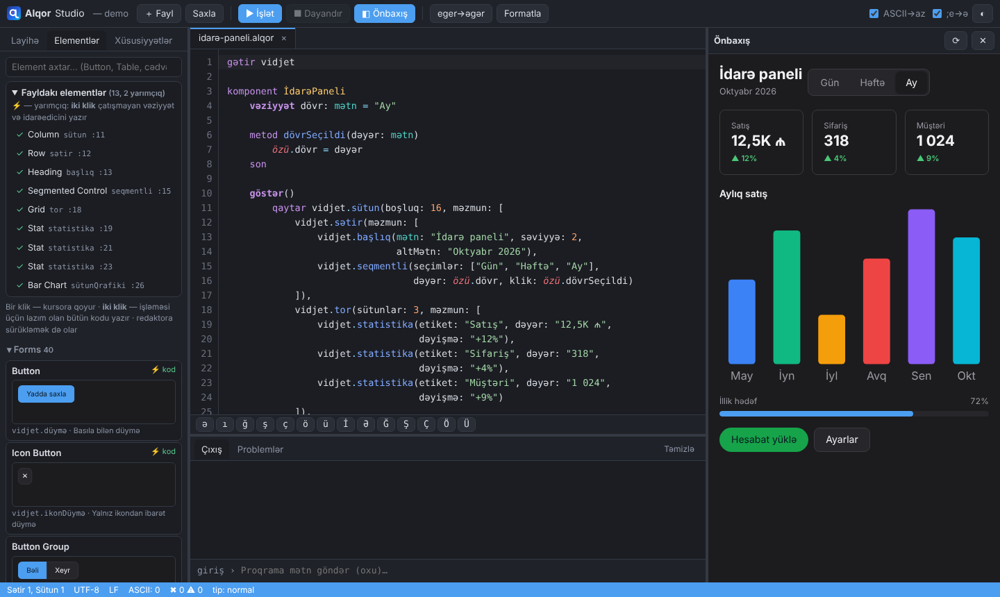
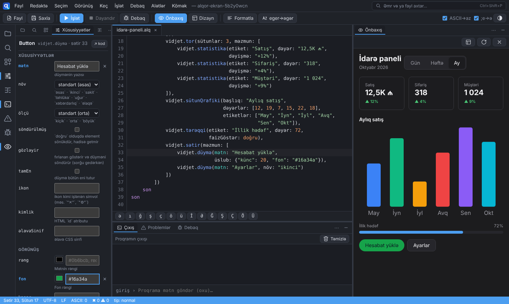
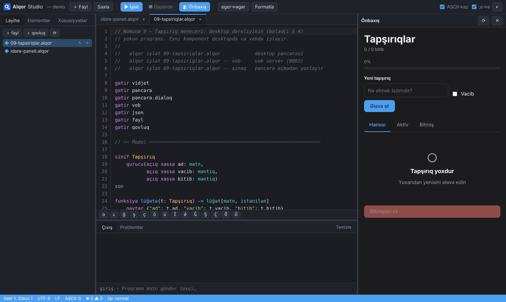

<p align="center">
  <picture>
    <source media="(prefers-color-scheme: dark)" srcset="loqo/alqor-loqo-qaranliq.svg">
    
  </picture>
</p>

# Alqor

**Azərbaycan dilində proqramlaşdırma dili.**
Veb, desktop və konsol tətbiqləri üçün. Linux əsaslı.

```alqor
yaz("Adınızı daxil edin:")
dəyişən ad = oxu()

yaz("Yaşınızı daxil edin:")
dəyişən yaş = oxuTam()

əgər yaş >= 18 onda
    yaz("{ad}, siz yetkinsiniz.")
yoxsa
    yaz("{ad}, siz hələ yetkin deyilsiniz.")
son
```

## Ekran görüntüləri

**Alqor Studio** — redaktor, element paleti (118 element, miniatürlü) və
canlı önbaxış:



**Xüsusiyyətlər paneli** — elementin mətni, rəngi, kənarı, şrifti kod
yazmadan dəyişir; kod özü yazılır, önbaxış dərhal yenilənir:



**Desktop tətbiq** — `numuneler/09-tapsiriqlar.alqor` (tapşırıq meneceri),
eyni kod vebdə də işləyir:



---

## Layihənin vəziyyəti

| | |
|---|---|
| Mərhələ | **Dil nüvəsi + veb + desktop + vidjetlər + Alqor Studio** |
| Spesifikasiya | 1.0 (layihə) — 14 bölmə |
| Etalon implementasiya | Python 3.12 |
| Sınaqlar | **932 keçir** (+ Studio brauzer sınaqları) |
| Tarix | 6 oktyabr 2026 |

**Windows-da bir kliklə** (`alqor` qovluğunda):

| Fayl | Nə açır |
|---|---|
| `Studio-ac.cmd` | **Alqor Studio** — redaktor, vidjet paleti, icra, önbaxış |
| `Brauzerde-ac.cmd` | 08 nümunəsi brauzerdə (`Brauzerde-ac.cmd 10` — Kitab rəfi) |
| `Desktop-ac.cmd` | 06 nümunəsi desktop pəncərəsində |

**Layihə ilə işləmək** (`alqor.cmd` / `alqor` repo kökündədir):

```bash
alqor yeni mənim-saytım --şablon veb    # konsol | veb | desktop | kitabxana
cd mənim-saytım
alqor işlət          # işə sal
alqor sına           # sınaqlar (@sınaq)
alqor format .       # kodu səliqəyə sal
alqor sənəd          # sənəd/indeks.html — /// şərhlərindən
alqor qur            # qurma/mənim-saytım.pyz — tək fayllı paket
```

**Dil işləyir:**

```bash
cd alqorc
python alqorc.py söhbət                              # interaktiv rejim
python alqorc.py işlət ../numuneler/04-siniflər.alqor
python alqorc.py işlət ../numuneler/05-veb-server.alqor   # veb server
python alqorc.py işlət ../numuneler/06-desktop.alqor      # desktop
python alqorc.py işlət ../numuneler/08-vidjetler.alqor    # 118 vidjet
python alqorc.py işlət ../numuneler/09-tapsiriqlar.alqor  # tapşırıq meneceri
python alqorc.py işlət ../numuneler/10-kitab-refi/esas.alqor  # veb sayt
python alqorc.py studio ..                                # Alqor Studio
python alqorfmt.py ..                                     # formatlayıcı
python sina.py --nümunələr
```

```
alqor> 2 + 2
4  // tam

alqor> "ışıq".böyüyə()
"IŞIQ"  // mətn

alqor> hər i üçün 1..3 içində
  ...     yaz("Rəqəm: {i}")
  ... son
Rəqəm: 1
Rəqəm: 2
Rəqəm: 3
```

```
Dairə: sahə = 78.54, perimetr = 31.42
Düzbucaqlı: sahə = 12.00, perimetr = 14.00
Dairə: sahə = 19.63, perimetr = 15.71

Ümumi sahə: 110.17
Ən böyük: Dairə
```

---

## Dilin kimliyi

| Element | Ad |
|---|---|
| Dil | **Alqor** |
| Fayl uzantısı | `.alqor` (qısa: `.alq`) |
| CLI | `alqor` |
| Kompilyator | `alqorc` |
| İcra mühiti (VM) | `alqorvm` |
| Paket meneceri | `alqorpm` |
| Paket deposu | `alqorhub` |
| Formatter | `alqorfmt` |
| Linter | `alqorlint` |
| LSP serveri | `alqorls` |
| Test işlədici | `alqortest` |
| Sənəd generatoru | `alqordoc` |
| Redaktor / IDE | **Alqor Studio** |

> **Ad haqqında:** *Alqor* — Azərbaycan dilindəki "**alqoritm**" sözünün kökündən.
> `q` hərfi Azərbaycan latın əlifbasının imzasıdır və adı ingilis dilindəki
> `algor`-dan ayırır. Tam ASCII-təmizdir: `alqor`.

---

## Qərar verilmiş dizayn prinsipləri

| Məsələ | Qərar |
|---|---|
| **Əlifba** | Tam Azərbaycan latın əlifbası (`ə ı ğ ş ç ö ü İ`) |
| **Klaviatura** | Üç qatlı həll: redaktorda avtomatik çevirmə + `;` kompozisiyası + kompilyatorda ASCII qəbulu (xəbərdarlıqla) |
| **Tip sistemi** | Tədrici (gradual) — tip ixtiyari, yazılarsa yoxlanır |
| **Bloklar** | Açar sözlü (`əgər ... onda ... son`), girintidən asılı deyil |
| **Hədəflər** | Konsol, veb (JS/WASM), desktop (WebKitGTK), native ELF |
| **Paketləmə** | `.deb`, `.AppImage`, `.flatpak`, Docker, statik veb bundle |
| **Platforma** | Linux əsaslı, çarpaz-kompilyasiya ilə Windows/macOS |
| **Xəta mesajları** | Tam Azərbaycan dilində, düzəliş təklifi ilə |
| **İnkişaf sırası** | Platformadan asılı olmayan hissələr əvvəl |

---

## Sənədlər

### Dil Spesifikasiyası — `spesifikasiya/`

| Sənəd | Məzmun |
|---|---|
| [01 — Leksik Quruluş](spesifikasiya/01-LEKSIK-QURULUS.md) | Əlifba, Unicode, identifikatorlar, açar sözlər, literallar, ASCII əvəzləyiciləri, şərhlər |
| [02 — Tip Sistemi](spesifikasiya/02-TIP-SISTEMI.md) | Əsas və kompozit tiplər, ixtiyari tiplər, generiklər, çevirmə, dəyişməzlik |
| [03 — Dəyişənlər və Operatorlar](spesifikasiya/03-DEYISENLER-VE-OPERATORLAR.md) | Elan, əhatə dairəsi, bütün operatorlar, prioritet cədvəli, ifadələr |
| [04 — İdarəetmə Strukturları](spesifikasiya/04-IDAREETME-STRUKTURLARI.md) | `əgər`, `seç`, dövrlər, naxış uyğunlaşdırma, `gecikdir` |
| [05 — Funksiyalar](spesifikasiya/05-FUNKSIYALAR.md) | Parametrlər, lambda, qapanma, generatorlar, annotasiyalar |
| [06 — Obyekt Yönümlü](spesifikasiya/06-OBYEKT-YONUMLU.md) | Siniflər, miras, interfeys, struktur, sadalama, genişləndirmə |
| [07 — Xəta İdarəetməsi](spesifikasiya/07-XETA-IDAREETMESI.md) | `cəhd et`, xəta iyerarxiyası, `Nəticə` tipi, resurs idarəetməsi |
| [08 — Modullar və Paketlər](spesifikasiya/08-MODULLAR-VE-PAKETLER.md) | `gətir`/`ixrac et`, paket quruluşu, `layihe.alqor`, `alqorpm` |
| [09 — Asinxron və Paralel](spesifikasiya/09-ASINXRON-VE-PARALEL.md) | `asinxron`/`gözlə`, saplar, kanallar, axınlar |
| [10 — Standart Kitabxana](spesifikasiya/10-STANDART-KITABXANA.md) | Bütün modullar və funksiyalar |
| [11 — Veb Proqramlaşdırma](spesifikasiya/11-VEB-PROQRAMLASDIRMA.md) | Server, marşrutlar, şablonlar, komponentlər, təhlükəsizlik |
| [12 — Desktop və Konsol](spesifikasiya/12-DESKTOP-VE-KONSOL.md) | Pəncərələr, menyular, dialoqlar, paketləmə |
| [13 — Alət Zənciri](spesifikasiya/13-ALET-ZENCIRI.md) | CLI, formatter, linter, test, LSP, IDE, CI/CD |
| [14 — Vidjetlər](spesifikasiya/14-VIDJETLER.md) | 118 hazır element (Button, Table, Calendar, Charts …), hadisələr, üslub sistemi, IDE kataloqu (arayış koddan qurulur) |
| [Qrammatika (EBNF)](spesifikasiya/qrammatika.ebnf) | Rəsmi formal qrammatika |
| [Açar Sözlər](spesifikasiya/acar-sozler.md) | Tam siyahı + ASCII + beynəlxalq qarşılıqlar |

### İstifadəçi Bələdçisi — `beledci/`

| Sənəd | Kimə lazımdır |
|---|---|
| [1 — Başlanğıc](beledci/00-BASLANGIC.md) | Hamıya: quraşdırma, ilk proqram, 10 dəqiqəlik tur |
| [2 — Dil Dərsliyi](beledci/01-DIL-DERSLIYI.md) | Yeni başlayanlara: 17 dərs, tapşırıqlarla |
| [3 — Veb Dərsliyi](beledci/02-VEB-DERSLIYI.md) | Veb sayt: şablon, form, giriş, JSON API, canlı səhifə |
| [4 — Desktop Dərsliyi](beledci/03-DESKTOP-DERSLIYI.md) | Desktop tətbiq: komponent, vidjet, menyu, dialoq, fayl |
| [5 — Köçürmə Bələdçisi](beledci/04-KOCURME-BELEDCISI.md) | Python/JS/C#/PHP bilənlərə |
| [6 — Xəta Lüğəti](beledci/05-XETA-LUGETI.md) | Xəta ilə qarşılaşanlara |
| [7 — Tez Arayış](beledci/06-TEZ-ARAYIS.md) | Hamıya: bir səhifəlik xülasə |
| [8 — Vidjet Dərsliyi](beledci/07-VIDJET-DERSLIYI.md) | Hazır elementlər, hadisələr, düzülüş, tema, Studio |

Dərsliklər 3, 4 və 8-dəki hər tam proqram `sinaq/test_beledci.py` ilə
avtomatik ayrılır, tip yoxlamasından keçir və icra olunur.

---

## Texniki arxitektura (planlaşdırılan)

```
   mənbə.alqor (UTF-8)
        │
        ▼
 ┌──────────────────┐
 │ 1. NORMALLAŞDIR  │  NFC, BOM, homoqlif aşkarlanması
 └────────┬─────────┘
          ▼
 ┌──────────────────┐
 │ 2. LEKSER        │  Azərbaycan əlifba cədvəli, az-AZ hərf qaydaları
 └────────┬─────────┘
          ▼
 ┌──────────────────┐
 │ 3. PARSER        │  Rekursiv enmə + Pratt; Azərbaycanca xətalar
 └────────┬─────────┘
          ▼
 ┌──────────────────┐
 │ 4. SEMANTİK      │  Ad həlli, tədrici tip yoxlaması, axın daralması
 └────────┬─────────┘
          ▼
 ┌──────────────────┐
 │ 5. IR + OPT      │  SSA-bənzər aralıq forma
 └────────┬─────────┘
          ▼
   ┌──────┴──────┬──────────┬──────────┐
   ▼             ▼          ▼          ▼
 BYTECODE      NATIVE       JS        WASM
 (alqorvm)   (Cranelift)  (brauzer)  (hər yer)
             ELF/.deb/
             .AppImage
```

### Texnologiya seçimi

| Komponent | Texnologiya | Səbəb |
|---|---|---|
| Kompilyator nüvəsi | Rust | Dünyada ən yaxşı Unicode dəstəyi, tək statik binar, WASM hədəfi |
| Native backend | Cranelift → LLVM | Cranelift tez, Rust-nativ; LLVM sonra optimallaşdırma üçün |
| Veb backend | JS transpilyator + WASM | Brauzerdə heç nə quraşdırmadan işləsin |
| Desktop GUI | WebKitGTK (Tauri modeli) | Eyni UI kodu veb və desktopda |
| IDE | Tauri + CodeMirror 6 | Electron-dan 10× kiçik, Linux-nativ |
| LSP | tower-lsp | VS Code, Neovim, Zed dəstəyi |

---

## Yol xəritəsi

| Mərhələ | Nəticə | Vəziyyət |
|---|---|---|
| **0. Spesifikasiya** | Sintaksis sənədi, EBNF qrammatika, bələdçi | ✅ **Hazır** |
| **1. Lekser** | Token axını, az-AZ hərf qaydaları, Azərbaycanca xətalar | ✅ **Hazır** |
| **2. Parser** | Kod → AAC, 19 səviyyəli prioritet, naxış uyğunlaşdırma | ✅ **Hazır** |
| **3. İnterpretator** | `işlət` işləyir — siniflər, miras, qapanmalar, xətalar | ✅ **Hazır** |
| **4. Standart kitabxana** | 13 modul, ~250 funksiya | ✅ **Hazır** |
| **4b. REPL** (`alqor söhbət`) | Çoxsətirli giriş, 18 meta-əmr, tarixçə, tamamlama | ✅ **Hazır** |
| **5. Tip yoxlayıcı** | Tədrici tiplər, 3 rejim, axın daralması, 25 xəta kodu | ✅ **Hazır** |
| **5b. JSX** | Atributlar, komponentlər, parça, HTML qaçışı | ✅ **Hazır** |
| **5c. Korutinlər** | Tənbəl generatorlar + asinxron `paralel` | ✅ **Hazır** |
| 6. Veb backend | JS/WASM çıxışı + `veb` freymvorku | ⬜ |
| 7. Native + paketləmə | ELF, `.deb`, `.AppImage` | ⬜ |
| 8. Desktop UI | WebKitGTK pəncərələr | ⬜ |
| 9. Alqor Studio | Canlı önizləməli IDE | ⬜ |
| 10. alqorpm + alqorhub | Paket ekosistemi | ⬜ |
| 11. Sənəd saytı | alqor.az | ⬜ |

---

## Layihə quruluşu

```
PROQRAMLASDIRMA DILI/
├── README.md                 ← bu fayl
├── spesifikasiya/            ← dilin rəsmi tərifi
│   ├── 01-LEKSIK-QURULUS.md
│   ├── 02-TIP-SISTEMI.md
│   ├── 03-DEYISENLER-VE-OPERATORLAR.md
│   ├── 04-IDAREETME-STRUKTURLARI.md
│   ├── 05-FUNKSIYALAR.md
│   ├── 06-OBYEKT-YONUMLU.md
│   ├── 07-XETA-IDAREETMESI.md
│   ├── 08-MODULLAR-VE-PAKETLER.md
│   ├── 09-ASINXRON-VE-PARALEL.md
│   ├── 10-STANDART-KITABXANA.md
│   ├── 11-VEB-PROQRAMLASDIRMA.md
│   ├── 12-DESKTOP-VE-KONSOL.md
│   ├── 13-ALET-ZENCIRI.md
│   ├── qrammatika.ebnf
│   └── acar-sozler.md
├── beledci/                  ← istifadəçi bələdçisi
│   ├── 00-BASLANGIC.md
│   ├── 01-DIL-DERSLIYI.md
│   ├── 02-VEB-DERSLIYI.md
│   ├── 03-DESKTOP-DERSLIYI.md
│   ├── 04-KOCURME-BELEDCISI.md
│   ├── 05-XETA-LUGETI.md
│   └── 06-TEZ-ARAYIS.md
├── numuneler/                ← nümunə proqramlar
├── MUHIT.md                  ← Rust / Zig / WSL vəziyyəti
└── alqorc/                   ← etalon kompilyator (Python)
    ├── alqorc.py             CLI: işlət / söhbət / tip / yoxla / tokenlər
    ├── sina.py               sınaq işlədicisi
    ├── VEZIYYET.md           iş vəziyyəti + qərarlar + açıq məsələlər
    ├── alqor/
    │   ├── elifba.py         az-AZ hərf qaydaları, əlifba sırası
    │   ├── homoqlif.py       oxşar simvolların aşkarlanması
    │   ├── acar_sozler.py    açar sözlər + tip adları + aliaslar
    │   ├── token.py          Token, Yer, operator cədvəli
    │   ├── xeta.py           Diaqnostika, çərçivəli hesabat
    │   ├── menbe.py          UTF-8 → NFC → LF → mövqe xəritəsi
    │   ├── lekser.py         lekser (kontekst yığını + JSX skanı)
    │   ├── aac.py            abstrakt sintaksis ağacı
    │   ├── parser.py         rekursiv enmə + prioritet dırmaşması
    │   ├── parser_jsx.py     JSX oxuyucusu
    │   ├── tipler.py         tip təsviri və uyğunluq qaydaları
    │   ├── tipyoxlayici.py   statik tip yoxlayıcı
    │   ├── deyerler.py       icra dəyərləri, Mühit, Sinif, Element
    │   ├── korutin.py        Korutin, Gələcək, LəğvNişanı
    │   ├── icraci.py         ağac gəzən interpretator
    │   ├── kitabxana.py      standart kitabxana (16 modul)
    │   ├── veb.py            HTTP server, marşrutlar, sessiya
    │   ├── sablon.py         `.alqorhtml` şablon mühərriki
    │   ├── pencere.py        desktop: pəncərə, menyu, dialoq
    │   ├── vidjet.py         118 hazır element (veb + desktop)
    │   └── sohbet.py         interaktiv rejim (REPL)
    └── sinaq/                1034 sınaq
```

---

## Növbəti addım

Dil nüvəsi tamamdır. Növbəti ən faydalı işlər:

| # | İş | Nə açır |
|---|---|---|
| 1 | **`veb` modulu** (server) | `05-veb-server.alqor` işləyir, spesifikasiyanın 11-ci bölməsi canlanır |
| 2 | **`pəncərə` modulu** (desktop) | `06-desktop.alqor` işləyir |
| 3 | **`alqorfmt`** | `--ascii-düzəlt` — klaviatura həllinin üçüncü qatı |
| ✅ | **`alqorls`** (LSP) + VS Code genişlənməsi (`redaktor/vscode/`) | VS Code / Neovim / Helix dəstəyi |
| 5 | `alqor yeni` / `qur` / `sına` / `sənəd` | alət zəncirinin qalanı |
| 6 | JS/WASM transpilyator | brauzer hədəfi |
| 7 | Rust-a köçürmə | istehsal kompilyatoru |

### İnkişaf mühiti — [MUHIT.md](MUHIT.md)

| Alət | Vəziyyət |
|---|---|
| Python 3.12 | ✅ etalon implementasiya işləyir |
| **Rust 1.99** | ✅ quraşdırıldı |
| **Zig 0.16** (cross-linker) | ✅ quraşdırıldı |
| Linux ELF qurması (Windows-dan) | ✅ **təsdiqləndi** |
| WASM hədəfi | ✅ hazır |
| WSL / Linux mühiti | ⬜ **sizin təsdiqiniz lazımdır** (yenidən başlatma) |

Windows-dan həqiqi Linux ELF binarı artıq qurulur — WSL olmadan.
Desktop (WebKitGTK) və IDE (Tauri) üçün WSL məcburidir; addımlar
[MUHIT.md](MUHIT.md) faylındadır.

### Kodun açdığı spesifikasiya problemləri

İmplementasiya zamanı sənəddə **19 ziddiyyət** tapıldı və düzəldildi.
Ən əsas ikisi:

1. **`gətir riyaziyyatdan {kök}` işləmir** — `-dan` şəkilçisi sözə
   yapışır, lekser üçün `riyaziyyatdan` bir identifikatordur (`meydan`
   adlı modul sınardı). Əvəzinə: `gətir riyaziyyat.{kök}`
2. **`xassə mətn: mətn` işləmirdi** — tip adları açar söz idi, halbuki
   `mətn`, `tam`, `say` Azərbaycan dilində ən təbii sahə adlarıdır.
   Həll: tip adları artıq **öncədən elan olunmuş identifikatordur**
   (Go-da `int`, Rust-da `i32` kimi).

Tam siyahı: [alqorc/VEZIYYET.md](alqorc/VEZIYYET.md)
